<picture>
  <source media="(prefers-color-scheme: dark)" srcset="assets/header-dark.svg">
  
</picture>

<picture>
  <source media="(prefers-color-scheme: dark)" srcset="assets/terminal-dark.svg">
  
</picture>

<picture>
  <source media="(prefers-color-scheme: dark)" srcset="assets/label-work-dark.svg">
  
</picture>

<a href="https://github.com/lyra-planet/galforge"><picture><source media="(prefers-color-scheme: dark)" srcset="assets/proj-galforge-dark.svg"></picture></a>

<a href="https://github.com/lyra-planet/LyHarness"><picture><source media="(prefers-color-scheme: dark)" srcset="assets/proj-lyharness-dark.svg"></picture></a>
<picture><source media="(prefers-color-scheme: dark)" srcset="assets/proj-patchloom-dark.svg"></picture>

<a href="https://github.com/TencentCloud/TencentDB-Agent-Memory/pull/1281"><picture><source media="(prefers-color-scheme: dark)" srcset="assets/proj-tencentdb-agent-memory-dark.svg"></picture></a>
<a href="https://github.com/lyra-planet/BlendEmo"><picture><source media="(prefers-color-scheme: dark)" srcset="assets/proj-blendemo-dark.svg"></picture></a>

<a href="https://github.com/lyra-planet/GAL-Dreamer"><picture><source media="(prefers-color-scheme: dark)" srcset="assets/proj-gal-dreamer-dark.svg"></picture></a>
<a href="https://github.com/lyra-planet/Pipline"><picture><source media="(prefers-color-scheme: dark)" srcset="assets/proj-pipline-dark.svg"></picture></a>

<picture>
  <source media="(prefers-color-scheme: dark)" srcset="assets/label-numbers-dark.svg">
  
</picture>

<picture>
  <source media="(prefers-color-scheme: dark)" srcset="assets/tokens-dark.svg">
  
</picture>

<!-- usage:start -->

Daily numbers (updated 2026-11-26 06:52, UTC+8)

| Agent | Total | Output | Cache read | API calls | Sessions |
|---|--:|--:|--:|--:|--:|
| Claude Code | 156B | 618M | 152B | 462,649 | 2,589 |
| Codex | 1.67B | 6.49M | 1.64B | 10,755 | 122 |
| Antigravity | 1.24B | 8.16M | 1.08B | 4,399 | 57 |
| **Total** | **159B** | **632M** | **155B** | **477,803** | **2,768** |

| Date | Total | Claude | Codex | Agy | Output | API calls | Sessions |
|---|--:|--:|--:|--:|--:|--:|--:|
| 2026-11-26 | 3.61B | 3.61B | — | — | 51.3M | 13,866 | 21 |
| 2026-11-25 | 5.94B | 5.92B | 14.7M | 26.0k | 55.8M | 22,288 | 42 |
| 2026-11-24 | 6.55B | 6.45B | — | 107M | 51.4M | 22,863 | 48 |
| 2026-11-23 | 3.01B | 1.99B | 139M | 889M | 10.4M | 8,078 | 45 |
| 2026-11-22 | 6.34B | 6.27B | 29.4M | 40.0M | 12.0M | 12,360 | 23 |
| 2026-11-21 | 6.01B | 5.89B | 32.7M | 86.2M | 12.6M | 12,497 | 74 |
| 2026-11-20 | 1.95B | 1.72B | 231M | 2.19M | 5.55M | 5,807 | 48 |
| 2026-11-19 | 2.51B | 2.20B | 313M | — | 6.75M | 7,731 | 93 |
| 2026-11-18 | 8.21B | 8.01B | 204M | 2.85M | 23.8M | 21,316 | 95 |
| 2026-11-17 | 6.67B | 6.35B | 203M | 115M | 18.2M | 17,144 | 92 |
| 2026-11-16 | 5.32B | 5.30B | 15.1M | — | 13.5M | 12,852 | 84 |
| 2026-11-15 | 2.74B | 2.69B | 50.8M | — | 9.29M | 9,100 | 79 |
| 2026-11-14 | 2.37B | 2.37B | — | — | 8.50M | 8,378 | 122 |
| 2026-11-13 | 2.95B | 2.95B | — | — | 11.1M | 10,466 | 172 |
| 2026-11-12 | 5.06B | 5.06B | — | — | 20.9M | 20,078 | 179 |
| 2026-11-11 | 4.71B | 4.66B | 49.7M | — | 19.2M | 17,610 | 210 |
| 2026-11-10 | 8.07B | 8.06B | 12.7M | — | 35.9M | 25,604 | 211 |
| 2026-11-09 | 4.92B | 4.57B | 350M | — | 18.2M | 16,204 | 193 |
| 2026-11-08 | 6.52B | 6.50B | 27.1M | — | 19.7M | 20,018 | 157 |
| 2026-11-07 | 4.26B | 4.26B | — | — | 12.2M | 10,159 | 119 |
| 2026-11-06 | 5.55B | 5.55B | 1.34M | — | 16.0M | 14,824 | 153 |
| 2026-11-05 | 6.06B | 6.06B | — | — | 16.1M | 14,042 | 68 |
| 2026-11-04 | 5.93B | 5.93B | — | — | 18.6M | 14,816 | 57 |
| 2026-11-03 | 5.90B | 5.90B | — | — | 22.4M | 19,057 | 51 |
| 2026-11-02 | 6.03B | 6.03B | — | — | 21.1M | 18,034 | 47 |
| 2026-11-01 | 3.45B | 3.45B | — | — | 14.2M | 10,277 | 29 |
| 2026-10-31 | 2.01B | 2.01B | — | — | 6.13M | 4,648 | 33 |
| 2026-10-30 | 3.39B | 3.39B | — | — | 11.7M | 8,961 | 31 |
| 2026-10-29 | 3.80B | 3.80B | — | — | 13.4M | 11,001 | 35 |
| 2026-10-28 | 2.82B | 2.82B | — | — | 10.1M | 8,563 | 31 |
| 2026-10-27 | 5.44B | 5.44B | — | — | 18.2M | 15,120 | 29 |
| 2026-10-26 | 4.05B | 4.05B | — | — | 15.4M | 12,718 | 25 |
| 2026-10-25 | 2.88B | 2.88B | — | — | 12.2M | 13,795 | 20 |
| 2026-10-24 | 2.02B | 2.02B | — | — | 12.2M | 10,847 | 19 |
| 2026-10-23 | 987M | 987M | — | — | 3.79M | 2,616 | 11 |
| 2026-10-22 | 961M | 961M | — | — | 3.15M | 2,796 | 5 |
| 2026-10-21 | 314M | 314M | — | — | 1.57M | 1,175 | 16 |
| 2026-10-20 | 19.9M | 19.9M | — | — | 134k | 94 | 1 |

Raw data: [`data/usage.json`](data/usage.json)

<!-- usage:end -->
