<picture>
  <source media="(prefers-color-scheme: dark)" srcset="assets/header-dark.svg">
  
</picture>

<picture>
  <source media="(prefers-color-scheme: dark)" srcset="assets/terminal-dark.svg">
  
</picture>

<picture>
  <source media="(prefers-color-scheme: dark)" srcset="assets/label-work-dark.svg">
  
</picture>

<a href="https://github.com/lyra-planet/LyHarness"><picture><source media="(prefers-color-scheme: dark)" srcset="assets/proj-lyharness-dark.svg"></picture></a>
<picture><source media="(prefers-color-scheme: dark)" srcset="assets/proj-patchloom-dark.svg"></picture>

<a href="https://github.com/TencentCloud/TencentDB-Agent-Memory/pull/1281"><picture><source media="(prefers-color-scheme: dark)" srcset="assets/proj-tencentdb-agent-memory-dark.svg"></picture></a>
<a href="https://github.com/lyra-planet/BlendEmo"><picture><source media="(prefers-color-scheme: dark)" srcset="assets/proj-blendemo-dark.svg"></picture></a>

<a href="https://github.com/lyra-planet/GAL-Dreamer"><picture><source media="(prefers-color-scheme: dark)" srcset="assets/proj-gal-dreamer-dark.svg"></picture></a>
<a href="https://github.com/lyra-planet/Pipline"><picture><source media="(prefers-color-scheme: dark)" srcset="assets/proj-pipline-dark.svg"></picture></a>

<picture>
  <source media="(prefers-color-scheme: dark)" srcset="assets/label-numbers-dark.svg">
  
</picture>

<picture>
  <source media="(prefers-color-scheme: dark)" srcset="assets/tokens-dark.svg">
  
</picture>

<!-- usage:start -->

Daily numbers (updated 2026-10-31 07:50, UTC+8)

| Date | Total | Output | Cache read | API calls | Sessions |
|---|--:|--:|--:|--:|--:|
| 2026-10-31 | 156M | 271k | 155M | 225 | 7 |
| 2026-10-30 | 3.39B | 11.7M | 3.32B | 8,961 | 31 |
| 2026-10-29 | 3.80B | 13.4M | 3.69B | 11,001 | 34 |
| 2026-10-28 | 2.82B | 10.1M | 2.76B | 8,563 | 32 |
| 2026-10-27 | 5.44B | 18.2M | 5.34B | 15,120 | 29 |
| 2026-10-26 | 4.05B | 15.4M | 3.98B | 12,718 | 25 |
| 2026-10-25 | 2.88B | 12.2M | 2.79B | 13,795 | 20 |
| 2026-10-24 | 2.02B | 12.2M | 1.96B | 10,847 | 19 |
| 2026-10-23 | 999M | 3.87M | 983M | 2,722 | 15 |
| 2026-10-22 | 961M | 3.15M | 945M | 2,801 | 10 |
| 2026-10-21 | 317M | 1.61M | 308M | 1,224 | 25 |
| 2026-10-20 | 139M | 437k | 135M | 906 | 8 |

Raw data: [`data/claude-code-usage.json`](data/claude-code-usage.json)

<!-- usage:end -->

<a href="https://lyra-planet.github.io"><b>lyra-planet.github.io</b></a> · CV, writing and a live version of the chart above

Stats come from my local Claude Code session logs: each API response counted once, daily totals only, pushed by a cron job twice a day. Earlier work: <a href="https://github.com/lyra-planet/Twin-Automata">Twin-Automata</a> · <a href="https://github.com/lyra-planet/winter_sweet">winter_sweet</a>.
